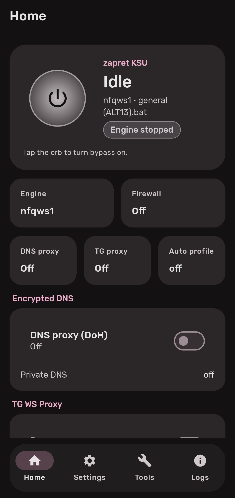
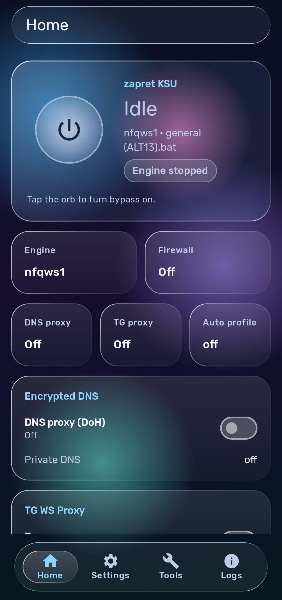

# zapret KSU

A KernelSU module and companion Android app that bypass DPI blocking with zapret. It runs nfqws (zapret 1) and nfqws2 (zapret 2), adds an encrypted DNS proxy, and gives you one screen to control all of it.

**Version 1.3.0** · KernelSU and KernelSU-Next · arm64 · Magisk and APatch untested

## Screenshots

<table>
  <tr>
    <td align="center"> Material 3</td>
    <td align="center"> Liquid Glass</td>
  </tr>
</table>

## Features

- **Two engines.** nfqws2 (zapret 2, presets, recommended) and nfqws1 (zapret 1, strategies with game filter and ipset).
- **Smart Mode.** Detects sites that reset or stall and adds them to the host list automatically.
- **Blockcheck.** Tests every preset against your blocked hosts and ranks the results.
- **Whitelist check.** Tells you whether you are on a whitelist network, and whether zapret is helping.
- **Per-app routing.** Include or exclude individual apps from the bypass.
- **Host lists.** Toggle services (YouTube, Discord, Instagram, X and more), add custom domains, edit and import or export every list.
- **Encrypted DNS.** A local DoH proxy (dnscrypt-proxy) with redirects for system DNS.
- **TG WS Proxy.** A local Telegram MTProto proxy, optionally shared on your Wi-Fi.
- **Auto network profile.** Separate engine, preset and interface for Wi-Fi and mobile data.
- **Quick Settings tiles** for zapret, DNS and TG proxy.
- **Backup and restore** of settings, lists and presets.
- **Logs** with level and text filters.
- **Two looks.** Material 3 with wallpaper colors, or Liquid Glass.

## Install

1. Flash `zapret-ksu-module.zip` in the KernelSU manager and reboot.
2. Install the app and grant it root.
3. Open **Tools → Updates** and tap **Update everything**.
4. In **Settings → Engine**, pick an engine and a preset or strategy.
5. On **Home**, tap the orb to start.

## Requirements

- KernelSU or KernelSU-Next with root granted to the app.
- Internet access for the first download.
- `curl` on the device (recommended). Without it, HTTPS certificates are not checked.

## Command line

Run from a root shell:

    sh /data/adb/modules/zapret-ksu/scripts/zapret-ctl.sh status
    sh /data/adb/modules/zapret-ksu/scripts/zapret-ctl.sh start
    sh /data/adb/modules/zapret-ksu/scripts/zapret-ctl.sh stop
    sh /data/adb/modules/zapret-ksu/scripts/zapret-ctl.sh emergency

`emergency` restores the network. Run the script without arguments for the full command list.

## Building

Module, from `module/`:

    zip -r ../zapret-ksu-module.zip . -x "*.git*"

App, from the project root:

    ./build-app.sh              # debug APK
    ./build-app.sh --release    # release APK

Needs JDK 17, 21 or 23, the Android SDK, and build-tools for `apksigner`.

## Credits

This project stands on the work of others. Thank you to:

| Project | Provides |
| --- | --- |
| [bol-van/zapret](https://github.com/bol-van/zapret) | nfqws, the zapret 1 engine |
| [bol-van/zapret2](https://github.com/bol-van/zapret2) | nfqws2, the zapret 2 engine |
| [Flowseal/zapret-discord-youtube](https://github.com/Flowseal/zapret-discord-youtube) | zapret 1 strategies |
| [zapret2-youtube-discord](https://git2.zapret.moe/zapretdiscordyoutube/zapret2-youtube-discord) | zapret 2 presets, Lua scripts, lists |
| [magisk-zapret2](https://git2.zapret.moe/zapretdiscordyoutube/magisk-zapret2) | module reference |
| [dnscrypt-proxy](https://github.com/DNSCrypt/dnscrypt-proxy) | encrypted DNS proxy |
| [libsu](https://github.com/topjohnwu/libsu) | root shell access in the app |
| [tg-ws-proxy-rs](https://github.com/valnesfjord/tg-ws-proxy-rs) | TG WS Proxy |
| [LiquidGlass](https://github.com/Abdullajon1881/LiquidGlass) | Liquid Glass rendering |
| [github.akams.cn](https://github.akams.cn/) | GitHub proxy for downloads |

## License

GPL-3.0-only. See `LICENSE`.
